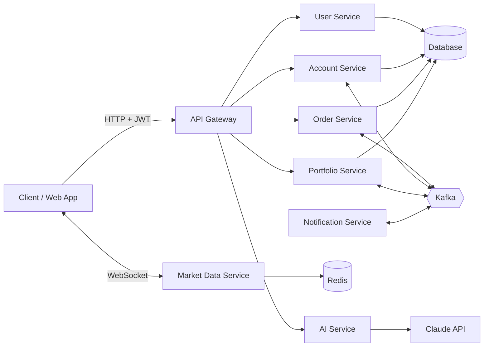

# 📈 Stock Trading Platform

A microservices-based stock trading platform built with **Spring Boot**, **JWT**, **WebSocket**, **Kafka**, **Redis**, and **Claude AI**.

> Live price fetched → AI analyzes your trade → funds deducted → portfolio updated → notification sent.


---

## 📑 Table of Contents

- [Features](#-features)
- [Tech Stack](#-tech-stack)
- [Architecture](#-architecture)
- [Services](#-services)
- [Trade Order Flow](#-trade-order-flow)
- [Getting Started](#-getting-started)
- [Configuration](#-configuration)
- [API Overview](#-api-overview)
- [Project Structure](#-project-structure)
- [Contributing](#-contributing)
- [License](#-license)

---

## ✨ Features

- 🔐 **Secure authentication** with JWT, validated centrally at the API Gateway
- 💹 **Real-time stock prices** streamed to clients over WebSocket
- 🛒 **Buy / Sell orders** with live price execution
- 🤖 **AI trade analysis** powered by Claude before you confirm a trade
- 💰 **Funds management**: add funds, check balance, automatic deduction on trade
- 📊 **Portfolio & holdings** tracking, updated automatically after each trade
- 🔔 **Notifications** sent when trades complete
- ⚡ **Event-driven** communication between services using Kafka
- 🚀 **Redis caching** for fast price and data lookups

---

## 🧰 Tech Stack

| Layer | Technology |
|---|---|
| Language / Framework | Java, Spring Boot |
| Authentication | Spring Security, JWT |
| Real-time | WebSocket |
| Messaging | Apache Kafka |
| Caching | Redis |
| Database | Relational DB (via data-service setup) |
| AI | Claude (Anthropic API) |
| Gateway | Spring Cloud Gateway |
| Build Tool | Maven / Gradle |

---

## 🏗 Architecture

The platform follows a microservices architecture. All client traffic enters through the **API Gateway**, which validates the JWT and routes requests to the appropriate service. Services communicate asynchronously through **Kafka** for events such as order placement, fund deduction, and notifications.



---

## 🧩 Services

| Service | Responsibility |
|---|---|
| **api-gateway** | Single entry point, routing, JWT validation |
| **user-service** | Registration, login, JWT issuance, user profile |
| **account-service** | Wallet / funds management (add funds, balance, deductions) |
| **market-data-service** | Stock data, real-time price updates, WebSocket streaming |
| **order-service** | Place and manage BUY / SELL orders |
| **portfolio-service** | Holdings and portfolio calculations |
| **notification-service** | Sends notifications for trade events |
| **ai-service** | Trade analysis using Claude AI |
| **data-service** | Database, Kafka, and Redis infrastructure setup |

---

## 🔄 Trade Order Flow

1. The user logs in and receives a **JWT**.
2. The client subscribes to **live prices** over WebSocket.
3. The user submits a **BUY / SELL** order through the API Gateway.
4. The **AI service** analyzes the trade and returns insights.
5. The **order service** validates the order and publishes an event to **Kafka**.
6. The **account service** checks and **deducts funds** (or credits them on a sell).
7. The **portfolio service** **updates holdings**.
8. The **notification service** **notifies the user** of the result.

---

## 🚀 Getting Started

### Prerequisites

- Java 17+
- Maven or Gradle
- Docker and Docker Compose (for Kafka, Redis, and the database)
- An [Anthropic API key](https://console.anthropic.com/) for the AI service

### 1. Clone the repository

```bash
git clone https://github.com/<your-username>/<your-repo>.git
cd <your-repo>
```

### 2. Start infrastructure

```bash
docker-compose up -d
```

This starts Kafka, Redis, and the database.

### 3. Set environment variables

```bash
export ANTHROPIC_API_KEY=your_api_key_here
export JWT_SECRET=your_jwt_secret_here
```

### 4. Run the services

Start each service from its own directory (a suggested order):

```bash
# 1. Core services
cd user-service && ./mvnw spring-boot:run
cd account-service && ./mvnw spring-boot:run
cd market-data-service && ./mvnw spring-boot:run
cd order-service && ./mvnw spring-boot:run
cd portfolio-service && ./mvnw spring-boot:run
cd notification-service && ./mvnw spring-boot:run
cd ai-service && ./mvnw spring-boot:run

# 2. Gateway last
cd api-gateway && ./mvnw spring-boot:run
```

---

## ⚙️ Configuration

Each service has its own `application.yml` / `application.properties`. Key settings:

| Property | Description |
|---|---|
| `spring.datasource.*` | Database connection |
| `spring.kafka.bootstrap-servers` | Kafka broker address |
| `spring.data.redis.host` / `port` | Redis connection |
| `jwt.secret` | Secret used to sign and verify JWTs |
| `anthropic.api-key` | API key for Claude (ai-service) |

> ⚠️ Never commit secrets. Use environment variables or a secrets manager.

---

## 📡 API Overview

All requests go through the API Gateway. Protected endpoints require the header:

```
Authorization: Bearer <JWT_TOKEN>
```

> Endpoint paths below are illustrative. Adjust them to match your implementation.

| Area | Method | Endpoint | Description |
|---|---|---|---|
| Auth | POST | `/api/users/register` | Register a new user |
| Auth | POST | `/api/users/login` | Login and receive JWT |
| Funds | POST | `/api/accounts/funds` | Add funds |
| Funds | GET | `/api/accounts/balance` | Get balance |
| Market | GET | `/api/market/stocks` | List stocks |
| Market | WS | `/ws/prices` | Real-time price stream |
| Orders | POST | `/api/orders` | Place a BUY / SELL order |
| Orders | GET | `/api/orders` | List orders |
| Portfolio | GET | `/api/portfolio/holdings` | Get current holdings |
| AI | POST | `/api/ai/analyze` | Get AI analysis for a trade |

---

## 📂 Project Structure

```
.
├── api-gateway/
├── user-service/
├── account-service/
├── market-data-service/
├── order-service/
├── portfolio-service/
├── notification-service/
├── ai-service/
├── data-service/
├── docker-compose.yml
├── LICENSE
└── README.md
```

---

## 🤝 Contributing

Contributions are welcome!

1. Fork the repository
2. Create a feature branch (`git checkout -b feature/amazing-feature`)
3. Commit your changes (`git commit -m "Add amazing feature"`)
4. Push to the branch (`git push origin feature/amazing-feature`)
5. Open a Pull Request

---

## ⚠️ Disclaimer

This project is for **educational purposes only**. It does not execute real trades and nothing here is financial advice. AI-generated analysis may be inaccurate.

---

## 📄 License

This project is licensed under the **MIT License**. See the [LICENSE](LICENSE) file for details.
